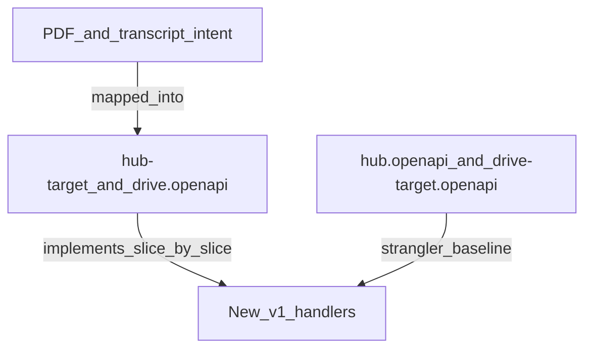

# API contracts

## Document hierarchy (frozen)

These layers are **not equal**. Implement and test against binding targets; use the PDF only as domain intent.

| Layer | Files | Role | Not |
|-------|-------|------|-----|
| **Domain intent** | [`Drive-API-contracts 2.pdf`](Drive-API-contracts%202.pdf), [`Drive-API-contracts.openapi.json`](Drive-API-contracts.openapi.json) | What the product does: people vs files, roles, flows | Binding URL/contract for `/api/v1` implementation |
| **Binding targets** | [`hub-target.openapi.json`](hub-target.openapi.json), [`drive.openapi.json`](drive.openapi.json) | **Source of truth** for new Hub/Drive `/api/v1` paths, ownership, auth | Description of today's running hosts |
| **Exported reality** | [`hub.openapi.json`](hub.openapi.json), [`drive-target.openapi.json`](drive-target.openapi.json) | What Hub.Api / parked Drive.Api currently expose (Swashbuckle export) | Target shape; may lag binding until cutover |

Rules:

1. **Contract-first.** Every PDF requirement that will ship must appear as a row in a binding target before implementation.
2. **Hub vs Drive ownership.** Hub target = identity, JWKS, people, invites, project membership, admin. Drive target = storage, content, dispatches. Auth/token issuance is **not** on Drive.
3. **Exports are reality, not goal.** Regenerating exports does not change binding targets. Export never overwrites `hub-target.openapi.json` or `drive.openapi.json`.



## Files

| File | Source | Notes |
|------|--------|-------|
| `hub-target.openapi.json` | Hand-written | Binding Hub `/api/v1` (auth, JWKS, people, invites, admin). Resource-oriented; see file `info` Legacy mapping and per-op `x-legacy-paths`. |
| `drive.openapi.json` | Hand-written | Binding Drive `/api/v1` (storage, content, dispatches only) |
| `hub.openapi.json` | Hub.Api export | Current Hub host surface |
| `drive-target.openapi.json` | Drive.Api export | Parked assets/scenes/flows/sessions surface |

Folder index: [README.md](README.md).

## Export OpenAPI

Prerequisites: .NET 10 SDK.

From the repository root:

```powershell
.\scripts\export-openapi.ps1
```

The script runs export tests that write `docs/hub.openapi.json` and `docs/drive-target.openapi.json`. Binding targets are left untouched.

After changing controllers, DTOs, or Swagger filters, re-run the script and commit the updated export JSON. Contract tests fail when a committed host file is stale.

## Postman

Regenerate [`Space.Api.postman_collection.json`](../Space.Api.postman_collection.json) from the Hub **export** (`hub.openapi.json`):

```powershell
.\scripts\export-postman.ps1
```

Set collection variables `baseUrl` and `accessToken` after import. Contract test `PostmanCollectionTests.CommittedPostmanCollection_matchesOpenApiExport` fails when the collection is stale.

## Live document

When a host is running, the same document is served at:

- `/swagger/v1/swagger.json`
- Swagger UI at `/swagger`
